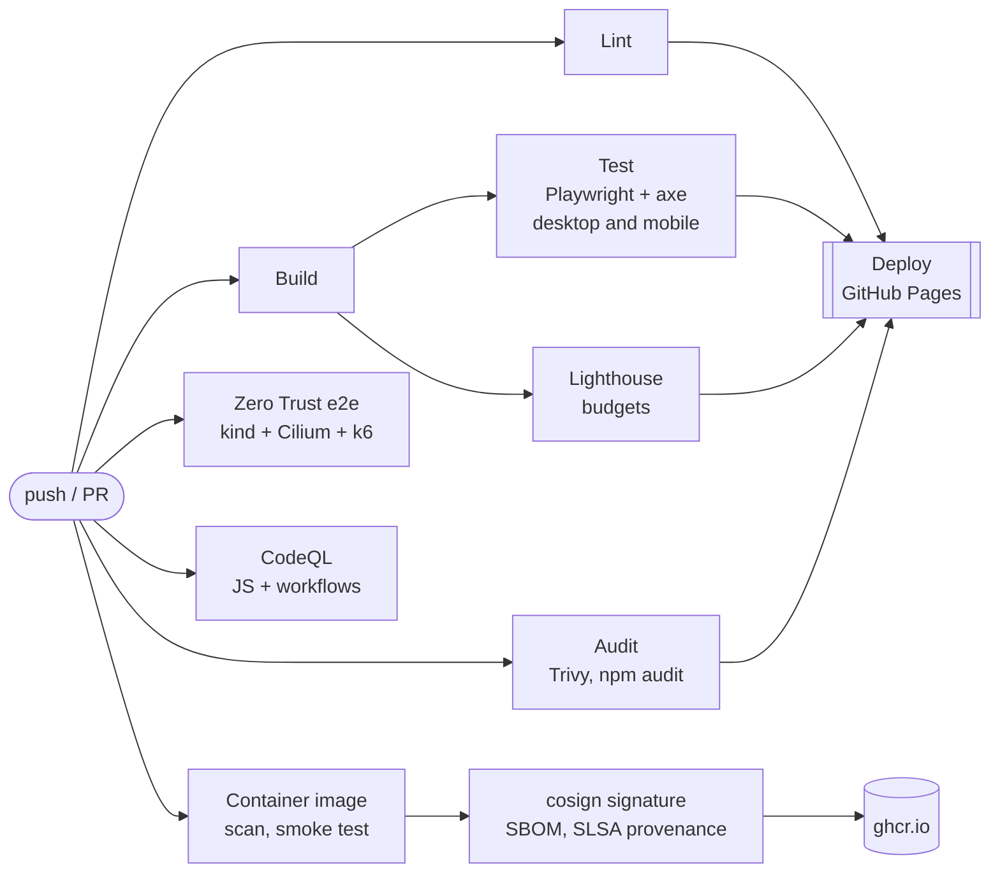

# Nawal Guerd, DevOps Engineer

[](https://github.com/louane20/portfolio/actions/workflows/ci-cd.yml)
[](https://github.com/louane20/portfolio/actions/workflows/container.yml)
[](https://github.com/louane20/portfolio/actions/workflows/zero-trust-e2e.yml)
[](https://github.com/louane20/portfolio/actions/workflows/codeql.yml)
[](https://scorecard.dev/viewer/?uri=github.com/louane20/portfolio)

My portfolio: production Kubernetes, GitOps delivery and Zero Trust network security.
The site is simple to read; the repository behind it is built and shipped like production software.

**Live:** https://louane20.github.io/portfolio/ &nbsp;·&nbsp; **Français :** https://louane20.github.io/portfolio/fr/ &nbsp;·&nbsp; **العربية:** https://louane20.github.io/portfolio/ar/

## What is in it

- **A professional one-page portfolio** in English, French and Arabic (right to left, with a
  self-hosted Arabic typeface that English and French pages never download): profile, expertise (with the tools
  I run in production marked as such), experience, research, projects, education, certifications
  and contact, with a one-click CV download.
- **A research diagram** that explains my IEEE WCNC 2025 paper in three steps: a flat network,
  network policies with Cilium, then a service mesh with Istio, each stopping the attack it can see.
- **A blog** ([`/blog/`](https://louane20.github.io/portfolio/blog/)) with illustrated articles on
  air-gapped Kubernetes, operators (CloudNativePG, Strimzi), Zero Trust for 5G, open source and this
  pipeline. Topic filters, a table of contents that follows the reading, an Atom feed and a social
  image per article. Diagrams are SVG and code is highlighted at build time: pages need no
  JavaScript to read, and they follow the light and dark themes.
- **Live delivery status.** The featured project reads the latest run of this repository's
  pipeline from the GitHub API.
- Light and dark themes, works without JavaScript, no tracker and no third-party request,
  WCAG 2.2 AA (axe), Lighthouse 100 on performance, accessibility, best practices and SEO.
- For terminal lovers, the same profile as a real man page:
  `curl -sL https://louane20.github.io/portfolio/guerd.1 | man -l -`

## The pipeline



| Workflow | What it proves |
| --- | --- |
| [`ci-cd.yml`](.github/workflows/ci-cd.yml) | Content schema, ESLint, Stylelint, actionlint (with ShellCheck), hadolint, yamllint, kubeconform with CRDs; a reproducible build; HTML validation, internal links and fragments, `mandoc -T lint`; Playwright end-to-end and axe accessibility tests on desktop and mobile; Lighthouse budgets; Trivy (dependencies, secrets, misconfigurations) to code scanning. Deploys to Pages only from `main`, only if all of it passed. |
| [`container.yml`](.github/workflows/container.yml) | Multi-arch image (amd64, arm64) without emulation, smoke-tested read-only and non-root, Trivy-scanned, pushed to GHCR, signed keylessly with cosign, with an SPDX SBOM attestation and SLSA build provenance. |
| [`zero-trust-e2e.yml`](.github/workflows/zero-trust-e2e.yml) | A kind cluster with Cilium. The site is deployed behind default-deny and a `CiliumNetworkPolicy`; the job checks that only the gateway gets through, that the L7 proxy answers 403 to anything but `GET`/`HEAD`, that other pods are dropped and that the site cannot reach the internet. Then k6, then the Hubble drops in the job summary. Weekly as well, to catch drift. |
| [`codeql.yml`](.github/workflows/codeql.yml) | CodeQL on the JavaScript and on the workflows. |
| [`scorecard.yml`](.github/workflows/scorecard.yml) | OpenSSF Scorecard, published for the badge above. |

Supply-chain rules that hold everywhere: every action is pinned to a commit SHA (see
[CVE-2026-33634](https://nvd.nist.gov/vuln/detail/CVE-2026-33634), when the tags of a popular
scanning action were force-pushed to malicious commits); every downloaded tool is checked
against a SHA-256 ([`install-tools.sh`](scripts/ci/install-tools.sh)); workflows start with no
permissions; `npm ci --ignore-scripts`; Dependabot keeps all of it current.

### Verify it yourself

```sh
cosign verify ghcr.io/louane20/portfolio:latest \
  --certificate-identity "https://github.com/louane20/portfolio/.github/workflows/container.yml@refs/heads/main" \
  --certificate-oidc-issuer https://token.actions.githubusercontent.com

gh attestation verify oci://ghcr.io/louane20/portfolio:latest --owner louane20
```

## Run it

```sh
npm ci --ignore-scripts
npm run dev          # http://127.0.0.1:4173/ (rebuilds on change)
make help            # every other task: lint, test, lighthouse, image, run, zero-trust, man...
```

Node 24 (see `.nvmrc`). `make zero-trust` needs Docker, and installs nothing behind your back:
`make tools` puts the pinned CLIs in `~/.local/bin`.

## Edit the content

Everything you read on the site lives in [`content/profile.yaml`](content/profile.yaml), in
English, French and Arabic (`en`, `fr`, `ar`), validated by [`content/schema.json`](content/schema.json). Blog posts are
Markdown files in [`content/blog/`](content/blog/). Push to `main` and the pipeline does the rest.

A post starts with front matter, checked at build time:

```yaml
---
title: Running Kubernetes behind an air gap
date: 2026-11-03
category: platform        # platform, security, delivery or open-source
cover: airgap             # an illustration from src/templates/blog/covers.mjs
featured: true            # optional: pinned at the top of the blog
draft: true               # optional: kept out of the build
summary: One or two sentences for the cards, the feed and search engines.
tags: [kubernetes, air-gapped]
---
```

In the body, on top of standard Markdown:

- ` ```yaml title="cluster.yaml" ` gives a code block a file name (any language works; the label
  defaults to the language);
- `> [!NOTE]`, `> [!TIP]`, `> [!WARNING]` and `> [!IMPORTANT]` make callouts;
- a ` ```diagram ` block containing a name from
  [`src/templates/blog/diagrams.mjs`](src/templates/blog/diagrams.mjs) inserts that diagram.

After adding a post or changing a title, `node scripts/render-images.mjs --posts` regenerates the
social images in `src/static/og/` (commit them with the post).

## Layout

```
content/            profile.yaml (EN + FR), schema.json, blog/*.md
src/templates/      page sections and the research diagram, rendered at build time
src/templates/blog/ blog pages, Markdown rendering, cover illustrations and article diagrams
src/scripts/        theme, menu, copy buttons, local time, live pipeline status, blog filters
src/styles/         design tokens (light and dark), layout, components
scripts/            build.mjs, serve.mjs, check-links.mjs, ci/*.sh
tests/              Playwright + axe (e2e/), k6 (load/)
deploy/             nginx config, kustomize base and overlays, kind, Argo CD
.github/            workflows, composite action, Dependabot
```

## Credits

Typeset in [Red Hat Display, Text and Mono](https://github.com/RedHatOfficial/RedHatFont)
(SIL Open Font License). Built on the shoulders of Kubernetes, Cilium, Istio, Argo CD, kind,
Sigstore, Trivy, Playwright, axe and Lighthouse.

Code: MIT. Content and résumé: © Nawal Guerd.
